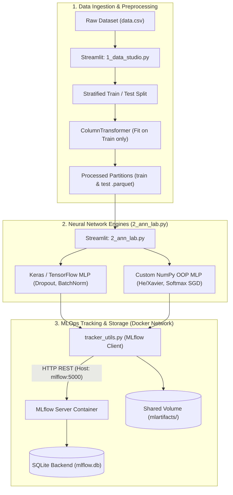

# ANN Playground : Multi-Layer Perceptron Laboratory

## Project Context

This project is part of the Master of Science Data / Artificial Intelligence curriculum delivered by [La Plateforme_](https://laplateforme.io/).

The primary objective is to study the theoretical and practical mechanics of Artificial Neural Networks (ANN), focusing on Multi-Layer Perceptrons (MLP) applied to tabular multi-class classification.

### Core Deliverables & Learning Objectives
1. **Exploratory Data Analysis & Leakage-Free Preprocessing**: Profile tabular distributions, detect implicit categorical variables masked as integer codes, handle linear multi-collinearity, and build reproducible train/test pipelines using `ColumnTransformer` and Parquet serialization.
2. **Deep Learning with Keras / TensorFlow**: Design, train, and benchmark MLP topologies, analyzing learning dynamics and convergence behavior across epochs.
3. **Overfitting Mitigation & Regularization**: Study the structural impact of Dropout regularization, Batch Normalization layers, and learning rate schedules on generalization gaps.
4. **Object-Oriented NumPy Implementation**: Build a functional Multi-Layer Perceptron from scratch using pure NumPy, implementing He/Xavier initializations, forward propagation, analytical backpropagation with softmax cross-entropy, and mini-batch stochastic gradient descent (SGD).
5. **Interactive Interface & MLOps Tracking**: Provide a modular, multi-page Streamlit dashboard coupled with a centralized MLflow tracking server using an SQLite backend for hyperparameter and metric auditability.

---

## System Architecture & Data Pipeline

The diagram below illustrates the data processing workflow, model training engines, and containerized orchestration between Streamlit and MLflow:



---

## Dataset

### Source
The experiment relies on the [Predict Students' Dropout and Academic Success](https://archive.ics.uci.edu/dataset/697/predict+students+dropout+and+academic+success) dataset, hosted on the UC Irvine Machine Learning Repository (UCI ID: 697).

### Dataset Overview
* **Observations**: 4,424 student enrollment records.
* **Features**: 36 predictive attributes covering demographic markers, socio-economic context, and semester-level curricular metrics.
* **Target Column**: Multi-class status (`Target`) with three categories:
  * `Dropout`
  * `Enrolled`
  * `Graduate`

### Preprocessing Strategy
* **Categorical Disambiguation**: Variables stored as `int64` (e.g., `Course`, `Nacionality`, `Mother's qualification`, `Father's qualification`, `Mother's occupation`, `Father's occupation`) represent non-ordinal categorical identifiers. These are isolated and transformed using One-Hot encoding (`drop='first'`) to prevent introducing arbitrary linear weightings.
* **Collinearity Elimination**: Curricular performance indicators between the 1st and 2nd semesters display linear correlations exceeding $\vert{}r\vert{} > 0.85$. Redundant attributes are arbitrated and pruned based on their correlation to the target variable.
* **Continuous Scaling**: Real-valued continuous variables and semester grades are scaled using `RobustScaler` or `StandardScaler`, fitted strictly on training data to prevent information leakage.

---

## Architecture & Modeling

### 1. Keras Sequential MLP
* Dynamic network assembly supporting configurable hidden layers, unit densities, and non-linear activations (`relu`, `tanh`, `sigmoid`).
* Multi-class classification head (`Dense(3, activation='softmax')`) paired with `sparse_categorical_crossentropy` loss.
* Regularization controls including variable `Dropout` rates (0.0 to 0.5) and `BatchNormalization`.
* Real-time training stream integrated into Streamlit via custom Keras callbacks (`StreamlitEpochCallback`).

### 2. Custom NumPy MLP (Object-Oriented Programming)
* Fully modular design located in `src/ann_playground/models/numpy_mlp.py`.
* Encapsulates `DenseLayer` (weights, biases, forward activation, and backward gradients) and `NumpyMLP` classes.
* Weight initializations: He initialization for ReLU activations, Xavier/Glorot for Sigmoid/Tanh.
* Analytical vector backpropagation through dense layers and multi-class softmax cross-entropy loss.
* Vectorized mini-batch stochastic gradient descent (SGD) execution.

---

## Installation & Environment Setup

### Prerequisites
* Operating System: Linux / WSL2 (Ubuntu), macOS, or Windows 11
* Python 3.12
* Package manager `uv` installed ([Documentation](https://docs.astral.sh/uv/))
* Docker and Docker Compose (with BuildKit support)

### Local Setup
Clone the repository and synchronize locked dependencies (configured with CPU-only PyTorch wheels to minimize disk footprint):

```bash
git clone [https://github.com/](https://github.com/)<YOUR_USERNAME>/ANN-playground.git
cd ANN-playground
uv sync --frozen
```

---

## Application Workflow & Usage

### 1. Containerized Execution (Recommended)

The project uses a multi-stage `Dockerfile` leveraging BuildKit cache mounts for `uv` and strict host whitelisting for MLflow DNS rebinding protection.

Build and start the services in detached mode:

```bash
DOCKER_BUILDKIT=1 docker compose build
docker compose up -d
```

* **Streamlit Application**: [http://localhost:8501](http://localhost:8501)
* **MLflow Tracking UI**: [http://localhost:5000](http://localhost:5000)

To stop containers while preserving local SQLite and artifact persistence:

```bash
docker compose down
```

### 2. Local Standalone Execution

Start the local MLflow tracking server backed by SQLite:

```bash
uv run mlflow server \
  --backend-store-uri sqlite:///mlflow.db \
  --default-artifact-root ./mlartifacts \
  --port 5000
```

In a second terminal, launch the multi-page Streamlit dashboard:

```bash
PYTHONPATH=src uv run streamlit run src/ann_playground/apps/app.py
```

The interface provides navigation across two modules:
* **`1_data_studio`**: Structural data diagnostics, missing values analysis, univariate/bivariate distributions, collinearity filtering, and leakage-free Parquet export to `data/processed_data/`.
* **`2_ann_lab`**: Interactive MLP architecture builder, real-time training telemetry, multiclass confusion matrix, generalization gap analysis, and automated MLflow logging under the `ANN_Playground` experiment.

---

## Project Structure

Runtime artifacts (`mlflow.db`, `mlartifacts/`, `.venv/`, `__pycache__/`) are excluded from version control via `.gitignore` and `.dockerignore`.

```text
.
├── .dockerignore
├── .gitignore
├── Dockerfile
├── README.md
├── docker-compose.yml
├── pyproject.toml
├── uv.lock
├── data
│   ├── processed_data
│   │   ├── test_prepared.parquet
│   │   └── train_prepared.parquet
│   └── raw_data
│       └── data.csv
├── notebooks
│   └── 1_clean.ipynb
└── src
    └── ann_playground
        ├── __init__.py
        ├── cleaning_utils.py
        ├── config.py
        ├── eda_utils.py
        ├── model_utils.py
        ├── tracker_utils.py
        ├── apps
        │   ├── app.py
        │   └── pages
        │       ├── 1_data_studio.py
        │       └── 2_ann_lab.py
        └── models
            ├── __init__.py
            ├── keras_mlp.py
            ├── numpy_mlp.py
            └── train_baseline.py
```

---

## Technical Insights & Experimental Conclusions

* **Significance of Explicit Categorical Handling**: Encoding qualitative integer codes via One-Hot encoding prevents artificial ordering bias, allowing backpropagation gradients to converge cleanly across decision boundaries.
* **Overfitting Control**: Dense networks unconstrained by regularization rapidly overfit on this dataset due to high mutual information across semester evaluation features. Introducing a Dropout rate of 0.20 combined with Batch Normalization reduces the generalization gap without degrading overall test accuracy.
* **Keras vs. NumPy MLP Benchmark**: The custom NumPy OOP implementation confirms the analytical correctness of manual gradient derivation, achieving comparable convergence profiles to Keras on equivalent baseline architectures under mini-batch SGD.

---

## References & Bibliography

1. **UCI Machine Learning Repository**: Realinho, V., Vieira, M., Ferrao, J., & Martins, M. V. (2021). *Predict Students' Dropout and Academic Success*. [Dataset link](https://archive.ics.uci.edu/dataset/697/predict+students+dropout+and+academic+success).
2. **Deep Learning Theory**: Goodfellow, I., Bengio, Y., & Courville, A. (2016). *Deep Learning*. MIT Press. [https://www.deeplearningbook.org/](https://www.deeplearningbook.org/).
3. **Interactive Visualization**: Smilkov, D., Carter, S., Sculley, D., Viegas, F. B., & Wattenberg, M. (2016). *TensorFlow Playground*. [https://playground.tensorflow.org/](https://playground.tensorflow.org/).
4. **Dropout Regularization**: Srivastava, N., Hinton, G., Krizhevsky, A., Sutskever, I., & Salakhutdinov, R. (2014). *Dropout: A Simple Way to Prevent Neural Networks from Overfitting*. Journal of Machine Learning Research, 15(56), 1929-1958.
5. **Batch Normalization**: Ioffe, S., & Szegedy, C. (2015). *Batch Normalization: Accelerating Deep Network Training by Reducing Internal Covariate Shift*. ICML 2015.
